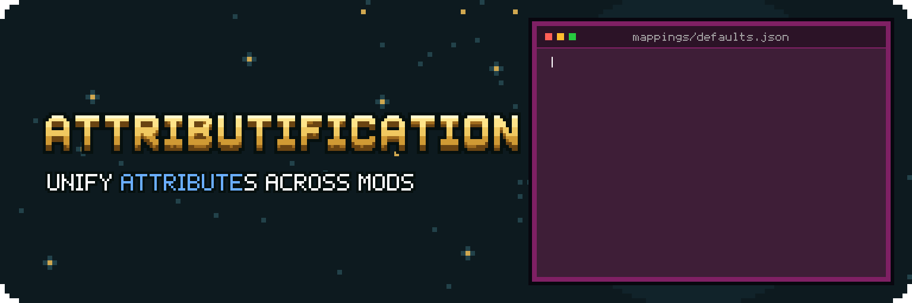
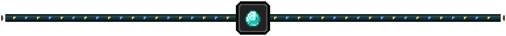

<p align="center">
<a href="https://www.curseforge.com/minecraft/mc-mods/attributification"></a>
<a href="https://modrinth.com/mod/attributification"></a>
<a href="https://github.com/UtherHel/attributification"></a>
</p>

**Two mods, one Fire Spell Power.** Spell Power counts fire power in points, Iron's Spells in percent, and gear from each mod feeds only its own number. Attributification maps an attribute of one mod onto the matching attribute of another: item bonuses move over at the right scale, and the old attribute keeps answering with the new value, so nothing that reads it breaks. Mappings are data-pack files; edit them in game or by hand. Minecraft Java 1.20 to 26.3: Fabric 1.20 - 26.3, Forge 1.20.1, NeoForge 1.20.3 - 1.20.6, 1.21.1 - 1.21.5 and 1.21.7 - 26.3. Install it on the server and on every client; Fabric needs Fabric API.


- **Mappings are data.** Each mapping lives in a data pack, in `data/<namespace>/attributification/mappings/<file>.json`. Ship them with a modpack, change them per world and apply them with `/reload`.
- **Bonuses move at the right scale.** `conversionEquivalence` divides an item's bonus on its way to the target: Spell Power's `+6` Fire becomes `+30%` Fire Spell Power (6 / 20). On the way a flat bonus can turn into a percentage.
- **The old attribute still answers.** Mods that read the source attribute get the target's value times `equivalence`, so their tooltips and formulas keep working.
- **Fallback targets.** List several targets and the first one that is installed gets the bonuses: Spell Power's Water goes to Traveloptics' Aqua Spell Power if it is there, otherwise to Iron's Spells' Nature.
- **Wildcards and exclusions.** `spell_power:*` maps a whole mod at once; `exclude` leaves some of its attributes out.
- **No double-dipping.** In `fullReplacement` mode the source attribute keeps only its base value and every item bonus goes to the target, so two crit chances from two mods never stack.
- **Clients see the same numbers.** The server sends its mappings to every player, so the HUD, the inventory and item tooltips match what the server computes.
- **An editor in the game.** `/attributification gui` (operators) lists every mapping file and edits it, with a search over all attributes. Your files are saved to a data pack in the world. Configs from Attributification 2.0 are found and converted when you ask.
- **Ready-made mappings,** 46 of them, for Spell Power, Iron's Spells, Apothic Attributes, Obscure API, Turtleboi's Core Library, GTBC's SpellLib, Ars Nouveau, Eidolon, Goety, Lodestone, Wizard's Reborn, Ranged Weapon API, More RPG Classes and Iter RPG. A mapping for mods you don't have does nothing.


Install it next to the mods whose attributes overlap. The built-in mappings start working on their own: a ring with Spell Power's Fire now raises Iron's Spells' Fire Spell Power, and `/attribute @s spell_power:fire get` still answers, with the unified value.

To add your own, open `/attributification gui` or put a file in a data pack, for example `data/mypack/attributification/mappings/earth.json`:

```json
{
  "mappings": [
    {
      "source": "spell_power:earth",
      "targets": ["gtbcs_geomancy_plus:geo_spell_power", "irons_spellbooks:nature_spell_power"],
      "equivalence": 3.0,
      "conversionEquivalence": 20.0,
      "operationConversion": "ADDITION_TO_MULTIPLY_BASE"
    }
  ]
}
```

Boots with `+6` Spell Power Earth now give `+30%` Geo Spell Power, or Nature Spell Power when Geomancy Plus is not installed. Asked for Earth, the player answers with the target's value times 3.


**Every mapping** is an entry of the `mappings` list:

| Field | Left out | What it does |
| --- | --- | --- |
| `source` / `sources` | - | the attribute to replace; `*` matches any part of the ID (`spell_power:*`) |
| `target` / `targets` | - | where its bonuses go; with several, the first installed one |
| `exclude` | none | IDs the wildcard skips |
| `mode` | `bidirectional` | `bidirectional`: the source reads as target x `equivalence`; `unidirectional`: reads of the source go to the target unscaled; `onlyVisualChange`: only the name in tooltips changes; `fullReplacement`: the source keeps its base value, all bonuses go to the target |
| `conversionEquivalence` | 0 (use `equivalence`) | item bonuses are divided by it on their way to the target |
| `equivalence` | 1 | the source reads as the target's value times this |
| `subtractValue` | 0 | taken off the target's value before `equivalence` |
| `operationConversion` | `DEFAULT` | `ADDITION_TO_MULTIPLY_BASE` or `ADDITION_TO_MULTIPLY_TOTAL` turn flat bonuses into percentages |

The built-in mappings are the mod's own data-pack file, `data/attributification/attributification/mappings/defaults.json`: a data pack with a file of the same path replaces it.

**Logging:** `logLevel` in `config/attributification.json` on Fabric or `config/attributification-common.toml` on Forge and NeoForge: `NONE`, `ERRORS`, `WARNINGS` (the default: also mistakes in mapping files) or `ALL` (also every conversion, for troubleshooting). A data pack can set it per world in `data/<namespace>/attributification/config.json`.

**Mistakes are reported.** After every load the log names each problem with its file and mapping: an attribute ID with a typo (its mod is installed but has no such attribute), an unknown field or `mode`, a wildcard that matches nothing, a division by zero. Mappings for mods that are not installed are expected in a modpack and only counted. One summary line tells how many mappings are active.

**Same idea, for effects:** [Effectification](https://modrinth.com/mod/effectification).

<!-- promo:start -->
<!-- More from UtherHel: promo cards of other mods go here, two per row, as in the other pages. -->
<!-- promo:end -->


MIT License: free to use, modify, share and include in modpacks, as long as the copyright notice stays with it. See [LICENSE](https://github.com/UtherHel/attributification/blob/main/LICENSE).

Not an official Minecraft product. Not approved by or associated with Mojang or Microsoft.

**More from UtherHel:** [GitHub](https://github.com/UtherHel/attributification) (source and issues)

